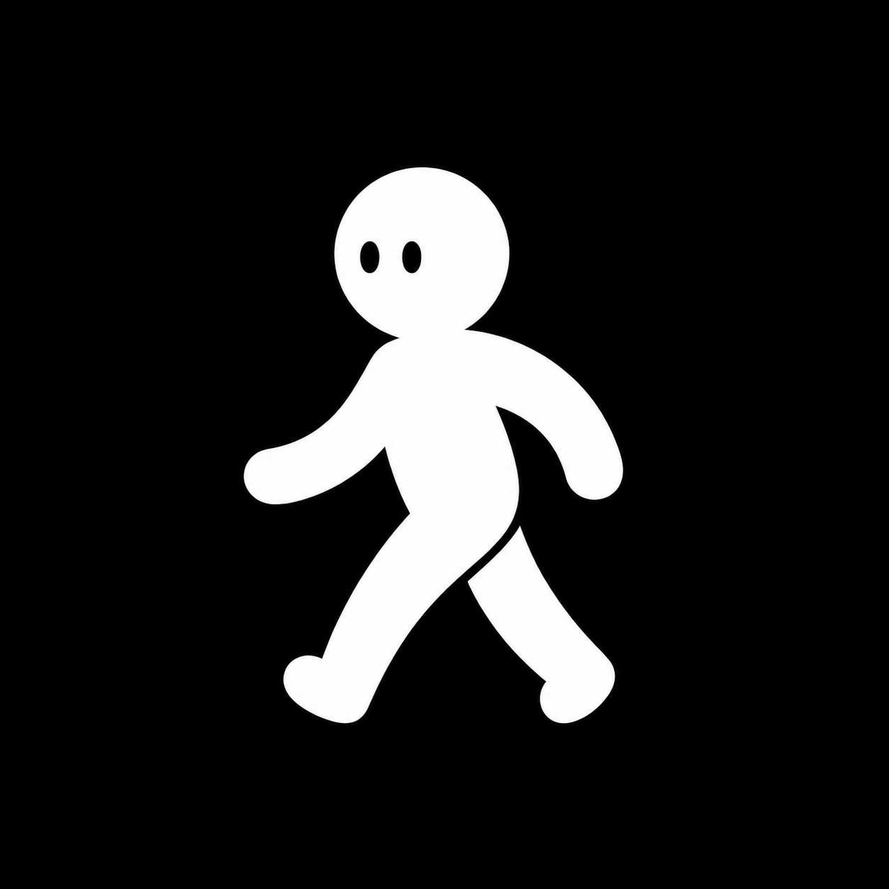
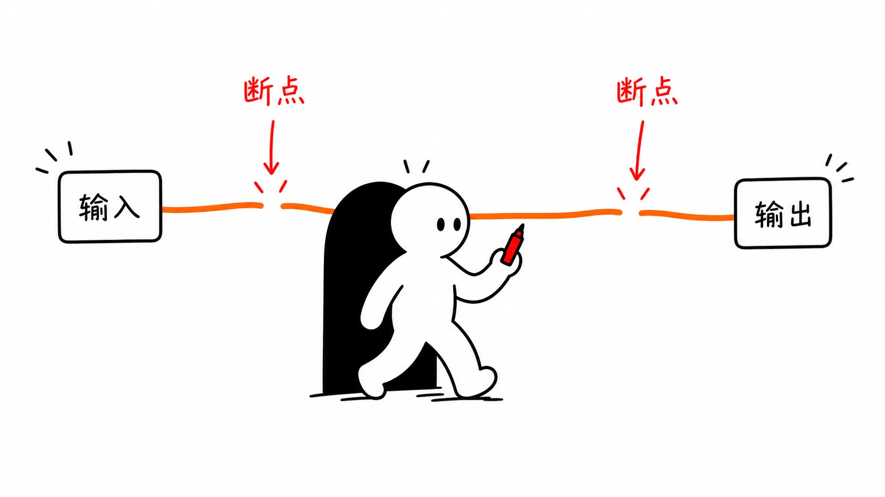
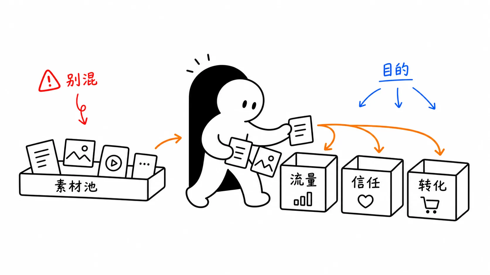
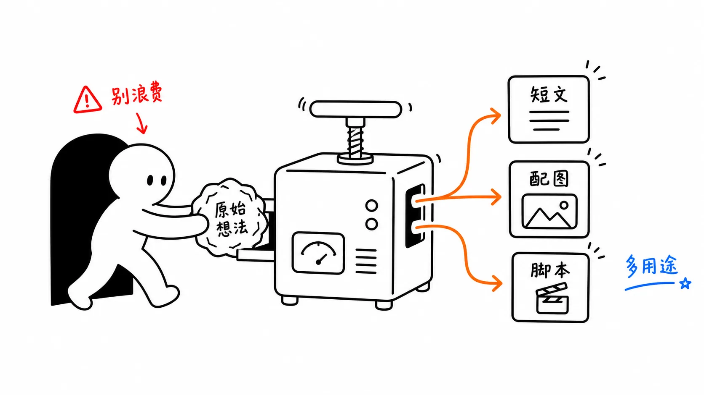
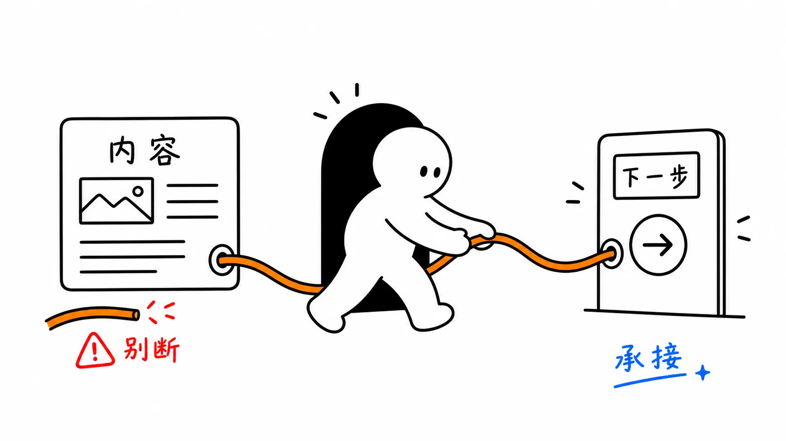
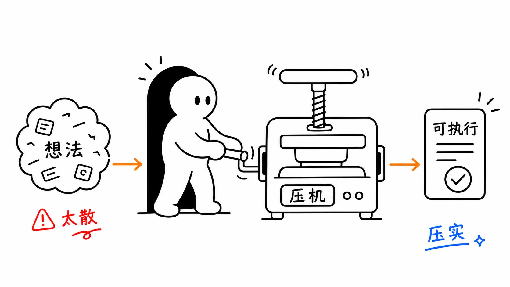
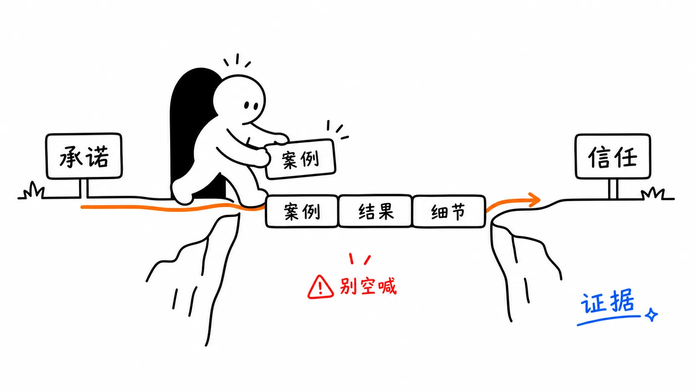

# Ai路人 Illustrations

> 把中文文章里的一个关键认知动作，画成一张白底、手绘、轻怪诞但清爽的 16:9 正文配图。

<p>
  
</p>

这是一个给 Codex 使用的中文正文配图 Skill。它会先理解文章里的判断、流程、状态或隐喻，再为每张图重新发明一个成立的物理隐喻，而不是把一段文字直接塞进 PPT 式信息图。

<p>
  <a href="#安装"></a>
  <a href="./LICENSE"></a>
  
</p>

## 先看它能画什么

以下是风格校准样例：每张图只表达一个认知锚点，Ai路人承担画面里的核心动作。

<table>
  <tr>
    <td></td>
    <td></td>
  </tr>
  <tr>
    <td></td>
    <td></td>
  </tr>
  <tr>
    <td></td>
    <td></td>
  </tr>
  <tr>
    <td></td>
    <td></td>
  </tr>
</table>

这些图片是校准样例，不是构图模板。使用时应从当前文章重新发明隐喻，不照抄旧案例的物件和布局。

## 它适合解决什么问题

如果你写的是中文文章、知识内容、方法论或 AI 工作流，希望读者一眼看懂一个抽象判断，这个 Skill 就适合你。

它尤其适合：

- 把抽象观点变成具体隐喻
- 为文章规划 4–8 张有节奏的正文配图
- 用同一套视觉语言持续制作内容
- 让 AI 先理解内容，再决定画什么

它不负责制作商业 KV、儿童卡通、传统 PPT 信息图、复杂架构图或可编辑 SVG。默认产出是 PNG 图片和 shot list，不是 PPTX、PDF 或 Keynote。

## 安装

```bash
git clone https://github.com/Ai-luren/Ailuren-illustrations.git
cd Ailuren-illustrations

mkdir -p "${CODEX_HOME:-$HOME/.codex}/skills"
cp -R ./ailuren-illustrations "${CODEX_HOME:-$HOME/.codex}/skills/"
```

真正需要安装的是子目录：

```text
ailuren-illustrations/
```

根目录的 README、`examples/`、`LICENSE` 和 `NOTICE.md` 是 GitHub 展示与说明文档。

## 第一次使用

安装后，在 Codex 中直接调用：

```text
Use $ailuren-illustrations 为这篇中文文章设计并生成 5 张 Ai路人正文配图。
要求：16:9 横版、纯白背景、黑色手绘线稿、少量红橙蓝中文批注。

<粘贴文章>
```

也可以先只做规划，不生成图片：

```text
Use $ailuren-illustrations 先不要生图。
请分析下面这篇文章哪里值得配图，输出 5 张左右的 shot list。
每张图写清楚：放在哪段后、主题、核心意思、结构类型、Ai路人在做什么、建议中文标注词。

<粘贴文章>
```

更多可复制示例见 [`examples/prompts.md`](examples/prompts.md)。

## 工作方式

```text
文章 / 主题
    ↓
提炼认知锚点
    ↓
输出 shot list
    ↓
为每张图重新发明物理隐喻
    ↓
生成 16:9 PNG
    ↓
检查白底、角色动作、留白、中文批注和风格一致性
```

每张图只讲一个核心结构。可选结构包括：Workflow、系统局部、前后对比、角色状态、概念隐喻、方法分层、地图路线和小漫画分镜。

## 视觉规则

- 纯白背景，不使用纸纹、米色、渐变和装饰性阴影
- 黑色细手绘线稿，允许轻微抖动
- Ai路人是白色圆润人形、黑色椭圆眼；在白底中必须有清楚轮廓
- 主体约占画面 40%–60%，保留足够留白
- 只使用少量红、橙、蓝中文批注
- Ai路人必须参与核心动作，不能只站在画面角落装饰
- 轻怪诞、有创意、清爽，但不幼稚、不卖萌

## 目录结构

```text
.
├── README.md                         # GitHub 对外说明
├── LICENSE
├── NOTICE.md                         # 上游来源与署名
├── assets/                           # GitHub 展示素材
│   ├── ailuren-ip.png
│   └── ailuren-qr.jpg
├── examples/                         # 对外示例与 prompt
│   ├── images/                       # 压缩后的 showcase WebP
│   └── prompts.md
└── ailuren-illustrations/            # 可安装的 Skill
    ├── SKILL.md
    ├── agents/openai.yaml
    ├── assets/examples/              # Skill 内部校准素材
    └── references/                   # 画风、构图、prompt、QA 规则
```

## 使用边界与 QA

- 图片里的中文文字越短越稳定；中文错字严重时，优先减少标注词并重生成。
- 不要把整篇文章做成说明书；一张图只讲一个核心结构。
- 如果去掉 Ai路人后画面仍然完全成立，说明角色承担的动作还不够明确。
- 示例图只用于校准线条密度、留白、颜色克制和角色参与方式，不要复刻构图。
- 生成后检查多余标题、幻觉标签、错字、角色轮廓、白底对比度和风格漂移。

完整规则见：

- [`ailuren-illustrations/SKILL.md`](ailuren-illustrations/SKILL.md)
- [`style-dna.md`](ailuren-illustrations/references/style-dna.md)
- [`composition-patterns.md`](ailuren-illustrations/references/composition-patterns.md)
- [`qa-checklist.md`](ailuren-illustrations/references/qa-checklist.md)

## 来源与许可证

本仓库基于上游开源项目改编，原项目来源和署名信息保留在 [`NOTICE.md`](NOTICE.md)。当前版本围绕 Ai路人 IP 重新定义了角色规则、画风 DNA、prompt 模板和 QA 标准。

MIT License，详见 [`LICENSE`](LICENSE)。

<p>
  
</p>
