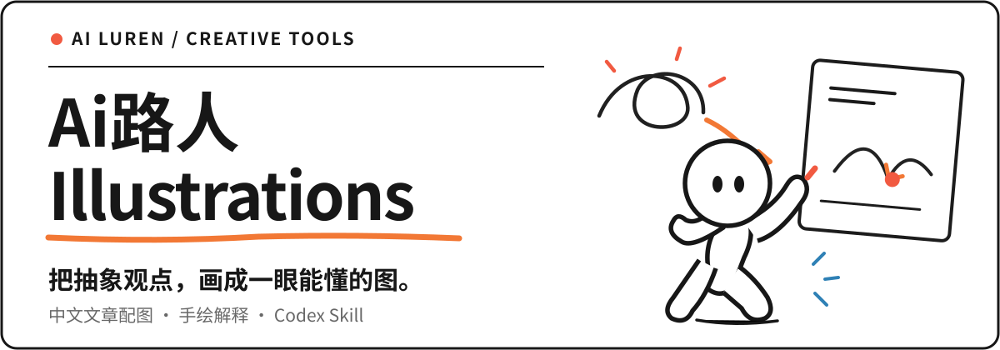

<p align="center">
  
</p>

<p align="center">
  <strong>让一个观点，不用解释那么多。</strong><br>
  专为中文文章、知识内容和方法论设计的 <strong>Codex 正文配图 Skill</strong>。<br>
  先理解内容，再找到值得画的认知锚点，最后用 Ai路人 IP 把它画出来。
</p>

<p align="center">
  <a href="#快速安装"><strong>开始使用</strong></a> &nbsp;·&nbsp;
  <a href="#看看它如何表达一个观点">浏览画面</a> &nbsp;·&nbsp;
  <a href="#复制即用">复制提示词</a> &nbsp;·&nbsp;
  <a href="./examples/prompts.md">更多示例</a>
</p>

<p align="center">
  <a href="#快速安装"></a>
  <a href="#画风原则"></a>
  <a href="./LICENSE"></a>
</p>

---

## 看看它如何表达一个观点

不是把段落塞进信息图，而是**让角色做一个动作，让读者看懂一层关系**。

<p align="center">
  <a href="./examples/images/02-sort-by-purpose.webp"></a>
</p>

<p align="center"><sub>01 / 分拣不是分类标签，而是把内容送去不同的目的地。</sub></p>

<p align="center">
  <a href="./examples/images/01-two-breakpoints.webp"></a>
  <a href="./examples/images/05-information-well.webp"></a>
</p>
<p align="center"><sub>02 / 关键断点 &nbsp;&nbsp;&nbsp;&nbsp; 03 / 信息提炼</sub></p>

<p align="center">
  <a href="./examples/images/06-idea-press.webp"></a>
  <a href="./examples/images/08-trust-bridge.webp"></a>
</p>
<p align="center"><sub>04 / 想法成形 &nbsp;&nbsp;&nbsp;&nbsp; 05 / 信任建立</sub></p>

<details>
<summary><strong>展开更多风格校准样例（3 张）</strong></summary>
<br>
<p align="center">
  <a href="./examples/images/03-one-fish-many-uses.webp"></a>
  <a href="./examples/images/04-handoff-path.webp"></a>
</p>
<p align="center">
  <a href="./examples/images/07-content-fermentation.webp"></a>
</p>
</details>

> **关于样例：** 上面的 8 张图片是仓库现有的风格校准图，来源与署名见 [NOTICE.md](./NOTICE.md)。它们用来展示画面密度、留白和隐喻表达，**不是固定构图模板，也不代表每次输出都会相同**。

## 这不是另一套 PPT 插画模板

| 常见做法 | Ai路人 Illustrations 的方法 |
| --- | --- |
| 将整段文章浓缩成一页信息图 | 每张图只抓住**一个认知锚点** |
| 用符号和说明文字解释观点 | 把抽象关系变成**物理动作与隐喻** |
| 角色只是画面里的摆件 | 让 Ai路人**推动事情发生** |
| 整篇文章均匀插图 | 只在**理解需要转折**的地方配图 |

适合知识文章、方法论、AI 工作流说明、内容创作与观点表达。不适合商业 KV、精细产品渲染、复杂架构图或需要可编辑矢量源文件的场景。

## 从一段文字到一张图

```text
文章或观点
   ↓  找出值得解释的地方
认知锚点
   ↓  选择一个物理动作和视觉隐喻
Shot List（配图计划）
   ↓  让 Ai路人参与核心动作
16:9 PNG 正文配图
   ↓  校验风格、中文标注与角色轮廓
可交付的配图
```

可以先只做 shot list，确认配图策略后再生成。默认建议为一篇文章挑选 4–8 个关键画面，而不是逐段插图。

## 快速安装

克隆仓库后，只将其中的 **`ailuren-illustrations/`** 目录安装到 Codex 的 Skill 路径：

```bash
git clone https://github.com/Ai-luren/Ailuren-illustrations.git
cd Ailuren-illustrations
mkdir -p "${CODEX_HOME:-$HOME/.codex}/skills"
cp -R ./ailuren-illustrations "${CODEX_HOME:-$HOME/.codex}/skills/"
```

> 根目录的 `README.md`、`examples/`、`NOTICE.md` 等是项目文档和展示素材，无需整体复制到 Skill 目录。

## 复制即用

**方案 A · 直接生成文章配图**

```text
Use $ailuren-illustrations 为下面这篇中文文章生成 4 张正文配图。
16:9 横版、纯白背景、黑色手绘线稿、少量红橙蓝中文批注。
每张只解释一个关键观点，让 Ai路人参与核心动作。

<粘贴文章>
```

**方案 B · 先规划，不生成图**

```text
Use $ailuren-illustrations 先分析下面的文章，不要生图。
只挑值得用画面解释的认知锚点，输出约 5 张 shot list。
说明每张图放在哪里、表达什么、角色在做什么。

<粘贴文章>
```

更多场景的完整提示词见 [`examples/prompts.md`](./examples/prompts.md)。

## 画风原则

<p align="center">
  
</p>

<p align="center"><sub>Ai路人 IP · 白色人形 / 黑色椭圆眼 / 无嘴无衣服</sub></p>

- **底色**：纯白，不添加纸纹、渐变、复杂阴影。
- **线条**：黑色手绘线稿；以留白构建呼吸感。
- **强调色**：少量红、橙、蓝；中文批注短而清楚。
- **构图**：每张图只讲一个结构，主体占比克制。
- **角色**：Ai路人必须参与关键动作，而非作为装饰。

完整创作规范：[画风 DNA](./ailuren-illustrations/references/style-dna.md) · [构图与原创隐喻](./ailuren-illustrations/references/composition-patterns.md) · [生成检查清单](./ailuren-illustrations/references/qa-checklist.md)。

<details>
<summary><strong>使用边界与常见问题</strong></summary>

- **能输出 SVG 或 PPT 吗？** 默认输出是 PNG 与 shot list，不提供可编辑 SVG、PPTX 或 Keynote。
- **中文会出现错字吗？** 生成图像的中文标注可能有误，需人工检查，必要时缩短标注并重新生成。
- **示例可以直接照画吗？** 不建议。示例用于校准视觉语言，新主题应重新设计隐喻。
- **角色变成机器人、黑色小人或吉祥物怎么办？** 以 [IP 规则](./ailuren-illustrations/references/ailuren-ip.md) 为准重新校正。

</details>

## 项目文件与来源

- [`ailuren-illustrations/SKILL.md`](./ailuren-illustrations/SKILL.md)：Skill 入口与执行流程。
- [`ailuren-illustrations/references/`](./ailuren-illustrations/references/)：风格、构图、角色、提示词及验收规范。
- [`examples/`](./examples/)：校准图与可复制提示词。
- [`NOTICE.md`](./NOTICE.md)：上游来源、示例署名与改编说明（请保留）。
- [`LICENSE`](./LICENSE)：MIT License。

<sub>由 Ai路人维护。保留原项目作者及示例图来源署名；改编范围详见 NOTICE。</sub>